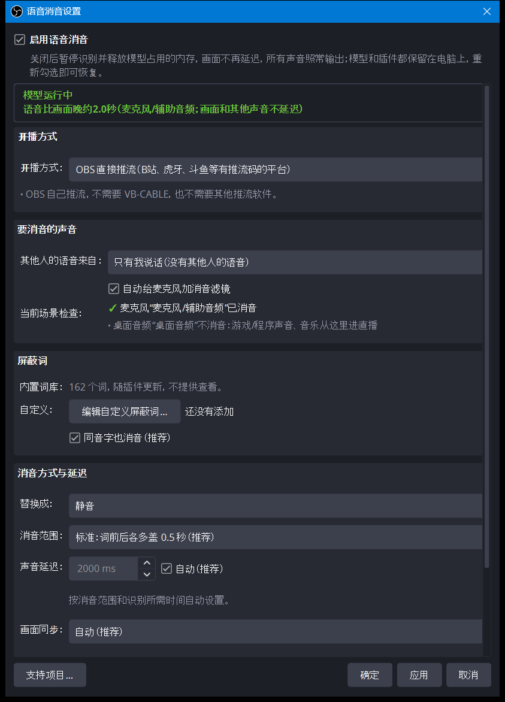
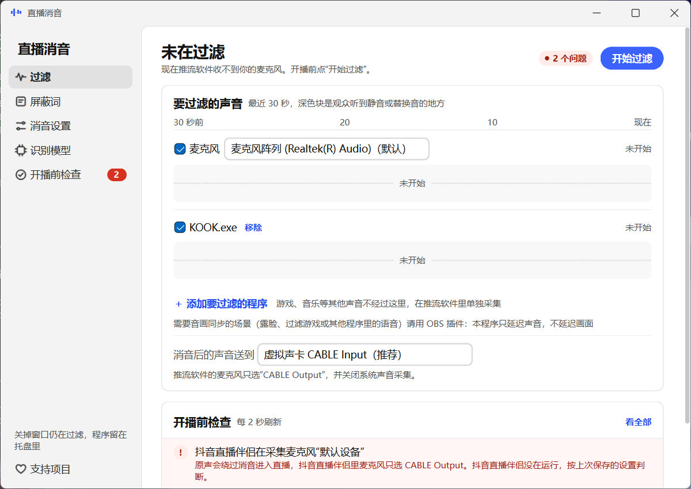

<div align="center">


# 直播消音 · 中文直播敏感词消音

**在声音播出前，自动把中文直播里的脏话、违禁词、敏感词替换成静音或哔声**

OBS 插件 ＋ 独立程序 · 本机离线识别，不上传 · 免费开源 · Windows

[](https://github.com/Mochall/live-speech-filter/releases/latest)
[](https://github.com/Mochall/live-speech-filter/releases)
[](LICENSE)


[下载](#下载) · [选哪个版本](#选哪个版本) · [快速开始](#快速开始) · [识别模型](#识别模型) · [常见问题](#常见问题) · [反馈](#反馈与支持)

</div>

---

**直播消音**是一款给中文主播用的**直播敏感词实时消音工具**。它在你的电脑上实时识别麦克风和语音软件里的中文语音，发现屏蔽词后，在观众听到之前把这一小段声音换成静音、哔声或其他音效，直播画面和其他声音照常播出。

- 内置常见脏话词库，装好即用；**带货违禁词、平台敏感词、品牌名等其他词由你自己添加**，保存后立即生效。
- 同音字也能消音：屏蔽了一个词，同音不同字的写法也会被消掉。
- 识别全部在本机完成（[X-ASR](https://github.com/Gilgamesh-J/X-ASR) 中英流式语音识别模型 + [sherpa-onnx](https://github.com/k2-fsa/sherpa-onnx)，只用 CPU），**声音不上传任何服务器**。详见[识别模型](#识别模型)。
- 支持 OBS 直接推流，也支持抖音直播伴侣、B 站直播姬、虎牙直播、斗鱼直播伴侣等推流软件。

> English: *Live Speech Filter* is a free, offline, real-time Chinese profanity / banned-word bleeper for live streaming on Windows. It ships as an OBS Studio plugin (audio and video delayed together) and a standalone app that outputs filtered audio through VB-CABLE to any streaming software. Speech recognition runs locally with sherpa-onnx; custom word lists are supported.

## 适合谁

| 场景 | 可以做什么 |
| --- | --- |
| 游戏直播、连麦开黑 | 过滤主播麦克风，以及 KOOK、YY、Discord、QQ 等语音软件里其他人说的话 |
| 电商带货直播 | 自己添加“最”“第一”“国家级”这类违禁词或平台敏感词，说漏嘴时自动消音 |
| 聊天、才艺、户外直播 | 过滤主播和连麦嘉宾脱口而出的脏话 |

> 识别不是百分之百准确。它能大幅减少脏话和违禁词进入直播，但不能代替主播自己注意用语，也不保证满足任何平台的审核要求。

## 选哪个版本

两个版本用同一套识别和消音代码，版本号相同。

| | OBS 插件 | 直播消音（独立程序） |
| --- | --- | --- |
| 适合谁 | 已经用 OBS 采集画面的主播 | 不用 OBS，直接用直播伴侣等推流软件的主播 |
| 音画同步 | ✅ 画面和其他声音会一起延迟，口型对得上 | ❌ 只延迟过滤的声音（约 1.4 秒），画面不延迟 |
| 能过滤什么 | 麦克风、语音软件、游戏或其他程序里的语音 | 麦克风、语音软件（KOOK 等） |
| 怎么开播 | OBS 直接推流；或者画面走 OBS 虚拟摄像头、声音走 VB-CABLE，进入直播伴侣类软件 | 声音输出到 VB-CABLE，推流软件的麦克风选 CABLE Output |
| 安装要求 | 已安装 OBS Studio 28 或更新版本，安装时需要管理员 | Windows 10 2004 或更新版本，不需要管理员 |

**简单判断：** 露脸直播、要过滤游戏内语音，或者本来就用 OBS → 选 **OBS 插件**；只想过滤自己的麦克风和 KOOK，不想装 OBS → 选 **直播消音**。

<table>
<tr>
<td width="50%"></td>
<td width="50%"></td>
</tr>
<tr>
<td align="center">OBS 插件：工具 → 语音消音设置</td>
<td align="center">直播消音：主窗口</td>
</tr>
</table>

## 下载

到 [Releases 页面](https://github.com/Mochall/live-speech-filter/releases/latest) 下载最新版：

| 文件 | 说明 |
| --- | --- |
| `LiveSpeechFilter-OBS-Plugin-<版本>-Windows-x64.exe` | OBS 插件安装包 |
| `LiveSpeechFilter-<版本>-Windows-x64.exe` | 直播消音（独立程序）安装包 |

- 识别模型已经包含在安装包里，不需要另外下载。
- 两个安装包都附带 [VB-CABLE](https://vb-audio.com/Cable/) 虚拟声卡的原版安装包，安装时可以选择是否安装。
- 安装包没有数字签名，Windows 可能提示“未知发布者”或 SmartScreen 拦截，点“更多信息 → 仍要运行”即可。每个安装包的 SHA256 写在 Release 说明里，可以用来核对。

## 快速开始

### OBS 插件

1. **完全退出 OBS**，运行插件安装包。“选择 OBS Studio”这一页会显示自动找到的 OBS 文件夹，确认是你平时用的那个。
2. 打开 OBS，菜单 **工具 → 语音消音设置**。默认设置一般不用改，场景里的麦克风会自动加上“语音消音”滤镜。
3. 选择 **开播方式**：
   - **OBS 直接推流**：B 站、虎牙、斗鱼等有推流码的平台；
   - **直播伴侣类推流软件**：画面走 OBS 虚拟摄像头，声音走 VB-CABLE。在推流软件里添加摄像头素材选 *OBS Virtual Camera*，麦克风只选 *CABLE Output*，并关闭系统声音。
4. 选择 **其他人的语音来自**：只有自己说话、语音软件（KOOK、YY、Discord、QQ 等），或者游戏等程序的声音里。
5. 照着设置页里的 **当前场景检查** 调整：红色 ✗ 必须处理，橙色 ？ 需要你确认，绿色 ✓ 表示正常。很多项目后面有“加消音”“静音”“不用消音”，点一下就能改好。
6. 在 **屏蔽词 → 编辑自定义屏蔽词…** 里添加你自己的词。
7. **开播前先在 OBS 里本地录一段**，说几个屏蔽词，回放确认消音和音画同步都正常。

详细说明：[使用说明-插件.txt](packaging/使用说明-插件.txt)

### 直播消音（独立程序）

1. 运行安装包，保持勾选“安装 VB-CABLE 虚拟声卡”。VB-CABLE 安装程序弹出后点 **Install Driver**，装完**重启电脑**。
2. 打开直播消音，勾选麦克风和要过滤的语音软件（默认 KOOK；点“添加要过滤的程序”可以加别的），然后点 **开始过滤**。
3. 在推流软件里：**麦克风只选 CABLE Output**，关闭系统声音（扬声器）采集，不要再添加真实麦克风。游戏、音乐等其他声音照常在推流软件里单独采集。
4. 看一眼 **开播前检查**，红色项要先处理。它会自动检查抖音直播伴侣、B 站直播姬、虎牙直播、斗鱼直播伴侣的设置。
5. 在左侧 **屏蔽词** 页添加你自己的词；在 **消音设置** 页选择换成静音、哔声，还是动物叫声等音效。
6. 关掉窗口后，程序会缩到右下角托盘里继续过滤。托盘图标上的点：绿色表示正在过滤，灰色表示还没开始，红色表示有问题。

详细说明：[使用说明-直播消音.txt](packaging/使用说明-直播消音.txt)

## 识别模型

安装包内置的语音识别模型是 **X-ASR zh-en 160ms 流式 int8**（约 130 MB，中英双语）：

| 项目 | 说明 |
| --- | --- |
| 模型 | [X-ASR](https://github.com/Gilgamesh-J/X-ASR)（[Hugging Face](https://huggingface.co/GilgameshWind/X-ASR-zh-en) · [ModelScope](https://www.modelscope.ai/Gilgamesh-J/X-ASR-zh-en)）：基于 icefall/k2 Zipformer 训练的流式语音识别模型；参与机构：上海交通大学、上海创智学院、复旦大学、华中科技大学 |
| 本项目使用的文件 | `sherpa-onnx-x-asr-160ms-streaming-zipformer-transducer-zh-en-int8-2026-06-05`，来自 [sherpa-onnx 模型发布页](https://github.com/k2-fsa/sherpa-onnx/releases/tag/asr-models)，未做修改 |
| 推理引擎 | [sherpa-onnx](https://github.com/k2-fsa/sherpa-onnx) 1.12.10 + [ONNX Runtime](https://onnxruntime.ai)，只用 CPU |
| 许可 | Apache-2.0；模型的 LICENSE 和 README 随安装包放在模型文件夹里 |

选它做默认模型的原因：在我们的两份测试素材上，它的命中不少于体积大得多的 2025 中文 FP32 模型，延迟、漏词和误消音之间最平衡，安装包也小。用来判断屏蔽词的是识别出的文字和拼音，所以识别准不准直接决定消音效果。

直播消音的“识别模型”页还可以下载另外三个 sherpa-onnx 中文模型（轻量 14M、中英双语 2023、中文 2025），它们由上游项目托管在 [ModelScope](https://modelscope.cn/models/cloud370/obs-profanity-filter)，同样只在本机运行。插件也可以在设置里选择其他模型文件夹。

## 常见问题

### 声音会上传吗？需要联网吗？

不会上传，也不用联网。识别模型随安装包装在本机，识别全部在本机进行。只有在直播消音的“识别模型”页里主动下载其他模型时，程序才会联网。

### 内置词库里有哪些词？能加带货违禁词吗？

内置词库是常见中文脏话，随版本更新，界面里不提供查看。带货违禁词（比如“最好”“第一”“国家级”）、平台敏感词、竞品名称等需要你自己添加：插件在设置页的“编辑自定义屏蔽词…”里加，直播消音在“屏蔽词”页里加，保存后立即生效，不用重新开播。项目不附带电商词库，因为各平台规则不同、变化也快，按自己的需要添加更准确。

### 同音字、谐音能识别吗？

可以。“同音字也消音”默认开启，会按拼音匹配，屏蔽了一个词，同音不同字的写法也会被消掉。

### 为什么直播会延迟？延迟多少？

要等一句话说出来、识别完，才能判断要不要消音，所以声音要先缓冲一下再播出。OBS 插件默认延迟 2 秒，并让画面一起延迟，保持音画同步；直播消音只延迟过滤的那几路声音，约 1.4 秒。观众一般察觉不到，只是和弹幕互动时会比平时晚一点。

### 吃配置吗？需要显卡吗？

不需要显卡，识别只用 CPU。同时过滤的声音路数越多，CPU 占用越高。第一次使用时，建议一边开着游戏或直播软件一边试一段，看看电脑是否吃得消。

### 支持哪些直播平台和推流软件？

- **OBS 插件**：OBS 能推流的平台都可以（B 站、虎牙、斗鱼等）；也可以接到抖音直播伴侣、B 站直播姬、虎牙直播、斗鱼直播伴侣这类推流软件。
- **直播消音**：只要推流软件能把麦克风选成 *CABLE Output* 就能用。抖音直播伴侣、B 站直播姬、虎牙直播、斗鱼直播伴侣会自动检查设置，其他推流软件需要你自己确认麦克风和系统声音的设置。

### 游戏声音、背景音乐会被消音吗？

不会。只有你指定的声音会被识别和消音：插件里是加了“语音消音”滤镜的来源，直播消音里是勾选的麦克风和程序。游戏声音、音乐、弹幕朗读默认都照常播出；需要的话，可以在插件的检查清单里给它们点“加消音”。

### 游戏内语音（队友说话）能过滤吗？

- **OBS 插件**：可以。把“其他人的语音来自”选为“游戏或其他程序的声音里”，插件会给这个程序的整个声音消音，并让画面一起延迟。
- **直播消音**：不行，因为它不延迟画面，过滤游戏声音会和画面对不上。请让队友改用 KOOK 等语音软件，或者改用 OBS 插件。

### 用了变声器还能识别吗？

识别效果会变差。插件和程序识别的是送进来的声音，如果用的是独立的变声软件，识别的就是变声后的声音。离线测试中，音调升降 3 个半音时命中率下降 1/5 到 3/5，机器人音基本识别不了。在 OBS 里用 VST 变声滤镜就没有这个问题，因为插件的消音滤镜排在最前面，识别的是原声。

### 安装后 OBS 里找不到“语音消音设置”？

- 确认安装时选的是你平时用的那个 OBS 文件夹，并且 OBS 是 28 或更新版本。
- 便携版 OBS（30 及以后）不读取 `C:\ProgramData\obs-studio\plugins`，插件装不进去，请用安装版 OBS。
- 安装前要完全退出 OBS（包括托盘图标）。

### 观众还是听到了屏蔽词？

1. 打开插件的“当前场景检查”或直播消音的“开播前检查”，看有没有红色项。最常见的原因是原声绕过了消音，比如推流软件里还选着真实麦克风、桌面音频没静音，或者声卡开了“内录/混音”。
2. 如果漏掉的是字头字尾，把“消音范围”调宽一些。
3. 生僻词、口齿不清、背景噪音大时容易识别不出，可以把这些词换个说法也加进自定义屏蔽词里。
4. 想知道刚才消掉了什么：插件在“语音消音设置 → 屏蔽词 → 最近消音：查看…”，直播消音在“屏蔽词”页底部，能看到时间、声音来源和消掉的词。需要排查漏词时打开“把识别出的文字写进日志”，日志里每句话会写一行识别出的文字（里面会有说话内容，查完记得关掉）。

### 怎么卸载？我的设置会丢吗？

在 Windows 设置 → 应用 里卸载“中文直播消音 OBS 插件”或“直播消音”即可。设置和自定义屏蔽词卸载后会保留，重装后还在：

- 插件：`%APPDATA%\obs-studio\plugin_config\obs-profanity-filter`
- 直播消音：`%APPDATA%\LiveSpeechFilter`

VB-CABLE 不会随之卸载；不需要时，在“应用”里卸载 *VBCABLE, The Virtual Audio Cable*。

### 收费吗？

免费，代码开源（GPL-2.0）。如果有帮助到你，可以用微信扫[下面的赞赏码](#反馈与支持)支持，程序里的“支持项目”页也是同一个码。

## 验证情况

已在开发机上验证：文件回放消音、KOOK 实时语音和主播麦克风的本地录制、抖音直播伴侣预览收到消音后的声音、一次用测试词的短时真实开播、OBS 28.0.3–33.0.1 加载插件、两个安装包的安装和卸载。

还没验证：其他电脑上的安装运行、真实游戏中的音画同步、平台观众端长时间直播。目前是测试版，**第一次使用请先本地录一段确认效果**，不要直接用于重要的正式直播。

## 反馈与支持

- 作者：漠秋
- 反馈 QQ：**549466926**
- 问题和建议：[GitHub Issues](https://github.com/Mochall/live-speech-filter/issues)
- 更新：[Releases](https://github.com/Mochall/live-speech-filter/releases)

本项目免费使用。如果它帮到了你，欢迎微信扫码赞赏，支持后续开发：

<p align="center"></p>

反馈问题时请说明使用的版本（插件还是直播消音、版本号）、推流软件和平台，尽量附上日志：插件看 OBS 菜单“帮助 → 日志文件”，直播消音的日志在 `%APPDATA%\LiveSpeechFilter`。

## 开发者

<details>
<summary>仓库结构与编译方法</summary>

本项目基于 [Cloud370/obs-profanity-filter](https://github.com/Cloud370/obs-profanity-filter) `7f0d445`（v0.3.0-beta.1，GPL-2.0），以补丁形式维护改动。

- `patches/`：对上游的补丁，按编号依次 `git apply` 即得插件源码，见 [patches/README.md](patches/README.md)（0001–0011 是普通 diff，其余是 `git format-patch` 格式）。
- `standalone/`：直播消音的源码（Qt 6），识别和消音部分直接编译打过补丁的上游源码，见 [standalone/README.md](standalone/README.md)。
- `packaging/`：两个安装程序的 Inno Setup 脚本和使用说明。
- `tools/`：组装安装包内容、生成 OBS 28 SDK、检查插件导入、单元测试的脚本。
- `docs/`：程序图标源文件和截图。

编译插件（Windows，Visual Studio 2026 生成工具）：

```bash
git clone https://github.com/Cloud370/obs-profanity-filter upstream/obs-profanity-filter
cd upstream/obs-profanity-filter
git checkout 7f0d445
for p in ../../patches/*.patch; do git apply "$p" || break; done
cd ../..
bash tools/make-obs28-sdk.sh        # 按 OBS 28.0.3 头文件配置 work/build-obs28
cmake --build work/build-obs28 --config Release --target obs-profanity-filter
```

直播消音的编译步骤见 [standalone/README.md](standalone/README.md)。识别模型（sherpa-onnx X-ASR zh-en 160ms int8，Apache-2.0，来源 https://github.com/Gilgamesh-J/X-ASR ）不在仓库里，组装安装包前需要另行下载。赞赏码图片是 `docs/images/sponsor-qr.png`；编译时把 `SPONSOR_IMAGE`（插件）/ `LSF_SPONSOR_IMAGE`（直播消音）设为这张图，程序里才会显示赞赏码。

</details>

## 许可与致谢

- 本项目以 GPL-2.0 发布（见 [LICENSE](LICENSE)），与上游相同。
- 上游插件：[Cloud370/obs-profanity-filter](https://github.com/Cloud370/obs-profanity-filter)。
- 语音识别模型：[X-ASR](https://github.com/Gilgamesh-J/X-ASR)（Apache-2.0），感谢 X-ASR 团队开源模型；模型训练用 [icefall](https://github.com/k2-fsa/icefall)。
- 推理引擎：[sherpa-onnx](https://github.com/k2-fsa/sherpa-onnx)（Apache-2.0）、[ONNX Runtime](https://onnxruntime.ai)（MIT）；拼音匹配：[cpp-pinyin](https://github.com/wolfgitpr/cpp-pinyin)（Apache-2.0）。
- 替换音效为 CC0（见 `standalone/data/sounds/README.md`）。第三方组件的许可随安装包放在 `licenses` 文件夹里。
- [VB-CABLE](https://vb-audio.com/Cable/) 是 VB-Audio Software 的捐赠软件（www.vb-cable.com），不属于本项目。VB-CABLE is a donationware, all participations are welcome.

<sub>关键词：直播消音、直播屏蔽词、直播敏感词过滤、直播脏话过滤、带货违禁词消音、OBS 消音插件、OBS 脏话过滤、实时语音消音、语音哔声、抖音直播伴侣消音、B 站直播姬、虎牙、斗鱼、KOOK 语音过滤、本地离线语音识别、X-ASR、sherpa-onnx、流式语音识别、profanity filter、bleep censor、OBS plugin</sub>
